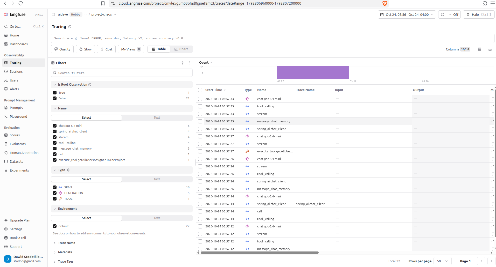
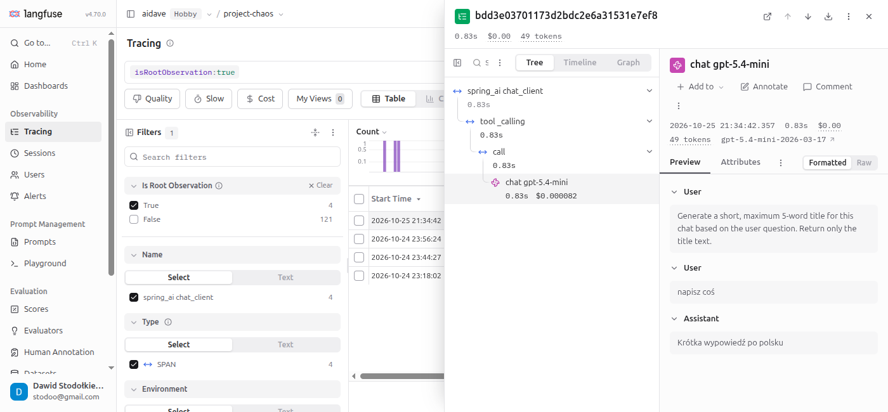

# Content capture

## Context

Langfuse shows the prompt of every observation in the column Input and the completion in the column Output.
These columns are empty by default.

## Two layers

Spring AI calls the model through two layers.

| Layer        | Span                    | Properties prefix                    |
|--------------|-------------------------|--------------------------------------|
| `ChatModel`  | `chat gpt-5.4-mini`     | `spring.ai.chat.observations`        |
| `ChatClient` | `spring_ai chat_client` | `spring.ai.chat.client.observations` |

`ChatModel` sends one request to OpenAI and returns one response.
`ChatClient` wraps `ChatModel`.
It runs the chat memory (the stored conversation history that is added to each prompt) and the tool calling loop.

The span `spring_ai chat_client` is the root observation.
It is explained in [06_root_observation.md](06_root_observation.md).

## Properties are not enough

Each prefix has two properties: `log-prompt` and `log-completion`.
Both default to `false`.

These properties do not fill Input and Output in Langfuse.
In Spring AI 2.0.1 the class `ChatModelPromptContentObservationHandler` only writes the prompt to the application log.
The prompt does not reach the span, so Langfuse does not receive it.

## Attributes read by Langfuse

Langfuse reads Input from the span attribute `gen_ai.prompt`.
Langfuse reads Output from the span attribute `gen_ai.completion`.

Spring AI does not set these attributes.
Spring AI records every call as an observation through Micrometer (the Spring instrumentation library), and Micrometer exports the observation as a span.
Each observation carries a context object: `ChatModelObservationContext` for a `ChatModel` call and `ChatClientObservationContext` for a `ChatClient` call.
An `ObservationFilter` is a hook that changes an observation before the export, for example by adding attributes.
The application adds the two attributes in a bean that implements `ObservationFilter`.

## Filter in the project

The class `ChatModelCompletionContentObservationFilter` in the package `config` adds both attributes.
It handles only `ChatModelObservationContext`, so it acts on the span `chat gpt-5.4-mini`.
It is based on the Langfuse example for Spring AI.

Token counts come from the attributes `gen_ai.usage.*`, not from the filter.

## What Langfuse shows now

With the filter the span `chat gpt-5.4-mini` has Input and Output.
The Input lists all messages sent to the model: the system prompt first, the message of the user last.

## Number of model calls

One chat request creates several spans `chat gpt-5.4-mini`.
The model requests one tool per response.
After each tool call, `ChatClient` calls the model again with the tool result.

Example: a request that creates 3 tasks produced 6 model calls.

- Four model calls each request one tool: `createTask` three times and `getAllProjectTasks` once.
- The fifth model call returns the final answer.
- The sixth call probably generates the conversation title. Its Input starts with "Generate a short".
