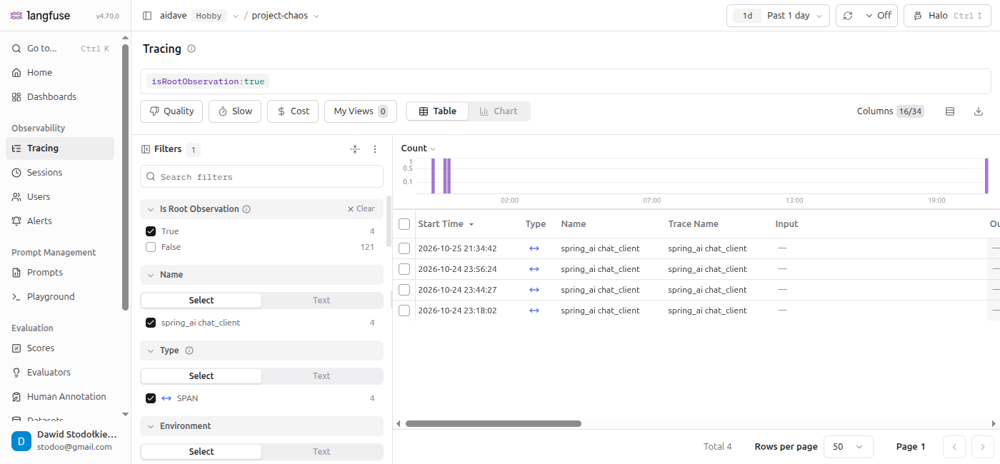

# Root observation

## Context

The page Tracing in Langfuse shows one row per observation (a single span, for example `chat gpt-5.4-mini` or `execute_tool getAllProjectTasks`), so one request fills many rows.

## Trace and root observation

The root observation is the top of the trace tree, the only observation without a parent.

In this project the root observation is `spring_ai chat_client`.
It covers the whole `ChatClient` call.
All other observations (`tool_calling`, `chat gpt-5.4-mini`, `stream`, `message_chat_memory`) are its descendants.

## Finding the root observation in the table

The column Trace Name is filled only in the root observation.

The filter Is Root Observation = True in the left panel hides all other rows.
After this filter, one row in the table is one request.

