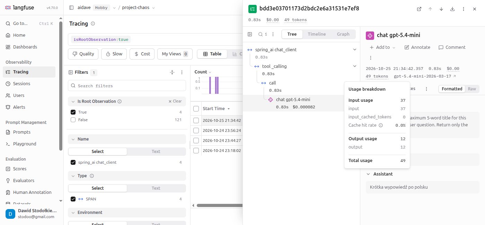
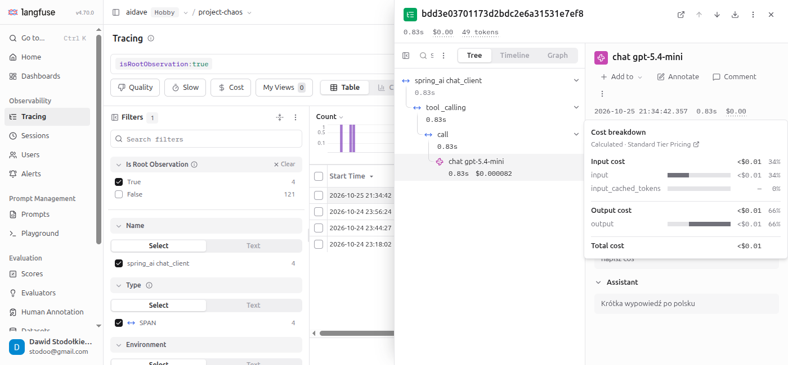

# Usage details and cost details

## Context

Langfuse records two values for every LLM call, which is an observation of type `generation`: usage details (tokens consumed, split by usage type such as `input` and `output`) and cost details (price in USD, split by the same usage types).

## Usage details

Providers add more usage types, for example `input_cached_tokens`.
Each token is counted in exactly one usage type.
The type `input` does not contain the cached tokens. They are stored in a separate type.

## Attributes that fill usage and cost

Langfuse receives spans over OTLP and maps their attributes to usage details and cost details.
Langfuse reads usage details from these attributes:

- `langfuse.observation.usage_details`, a JSON string. Attributes in the `langfuse.*` namespace take precedence over the generic ones.
- `gen_ai.usage.*`, the OpenTelemetry GenAI convention.
- `llm.token_count.*`, the OpenInference convention (an LLM tracing convention from Arize AI).

Langfuse reads cost details from `langfuse.observation.cost_details` (a JSON string) or from `gen_ai.usage.cost`.
Langfuse stores the value of `gen_ai.usage.cost` under the key `total`.

## Ingested and inferred cost

Cost reaches Langfuse in one of two ways:

- Ingested: the application sends the cost in USD, for example in `gen_ai.usage.cost`.
- Inferred: Langfuse calculates the cost. It multiplies the usage of each type by the price of that type from a model definition.

Ingested values take priority over inferred ones.

Spring AI sends only tokens, so Langfuse infers the cost.
The cost tooltip in the screenshot below shows the label `Calculated`.

## Model definition

A model definition is an entry with a price per usage type.
Langfuse stores the definitions in Project Settings > Models.

The field `match_pattern` is a regular expression.
Langfuse matches it against the whole value of the field `model` of the observation.
When no definition matches, Langfuse does not calculate the cost.

Langfuse ships a definition for the model of this project:

```
modelName:    gpt-5.4-mini-2026-03-17
matchPattern: (?i)^(openai\/)?(gpt-5.4-mini-2026-03-17)$
```

Each model version has its own definition, because prices differ between versions.
A definition added by the user takes priority over a definition maintained by Langfuse.
A new or changed definition applies only to observations received afterwards.

## Which observations carry the values

Only observations of type `generation` (model call) and `embedding` (embedding call) carry usage and cost. A plain `span` carries neither.
In this project the observations `chat gpt-5.4-mini` are generations. The Tracing table shows the type in the column Type.

## Example from this project

One observation `chat gpt-5.4-mini` stores these values:

```
usage: input 1938, output 113, total 2051
cost:  input 0.0014535, output 0.0005085, total 0.001962 (USD)
```

Langfuse shows the usage breakdown in a tooltip over the token count in the header of the observation:



Langfuse shows the cost breakdown in a tooltip over the cost in the same header:


