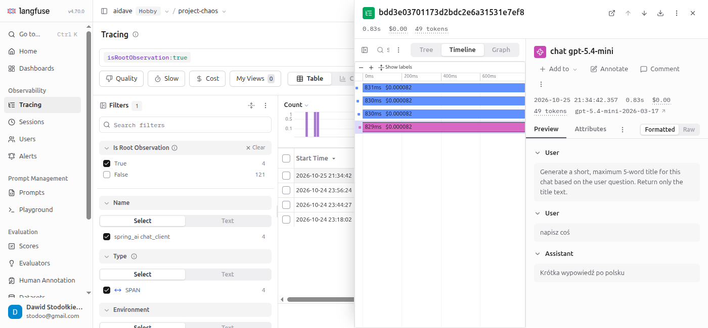

# Timeline

## Context

The tab Timeline in the window of a trace shows the trace as a Gantt chart (a chart with one horizontal bar per task).
Each observation has one bar.

## How to read the chart

- The horizontal axis is the time since the start of the trace.
- The left end of a bar is the start of the observation. The length of the bar is its duration.
- The color of a bar depends on the type of the observation: blue is a `span`, pink is a `generation`.
- The label of a bar shows the duration and the cost, for example `831ms $0.000082`.

## Nested observations

A bar of a parent observation covers the bars of its children.
In the trace above, `spring_ai chat_client`, `tool_calling`, `call` and `chat gpt-5.4-mini` are nested, so all four bars have almost the same length (about 830 ms).
The model call takes almost the whole time of the trace.
