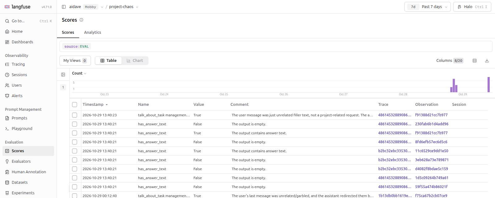

# Scores

## Context

A score is an evaluation result stored in Langfuse.
It has a name (for example `user_feedback`), a value and a data type.
An optional comment holds the reasoning or the notes of a reviewer.

A score refers to exactly one of these objects:

- a trace (one interaction, the most common case),
- an observation (one step of a trace, for example one model call),
- a session (a whole conversation),
- a dataset run (one run of a dataset, a later lesson).

An observation is one span. A trace is the tree of all observations of one request.
A score with a `traceId` evaluates the whole answer. A score with a `traceId` and an `observationId` evaluates one observation.

The menu item **Scores** in the section **Evaluation** opens the page that lists all scores of the project.
Each row shows the name, the value, the comment, the trace and the observation of one score.
The filter `source:EVAL` in the screenshot shows only the scores of evaluators.



## Data types

| Type          | Value                                       | Use for                                        |
|---------------|---------------------------------------------|------------------------------------------------|
| `NUMERIC`     | a float, for example `0.9`                  | relevance from 0 to 1, star ratings            |
| `CATEGORICAL` | a string from predefined categories         | `correct`, `partially correct`, `wrong`        |
| `BOOLEAN`     | `0` or `1`                                  | a hallucination check, thumbs up or down       |
| `TEXT`        | a free string of 1 to 500 characters        | notes of a reviewer                            |

Experiments (a later lesson), LLM-as-a-Judge and score analytics work with `NUMERIC`, `CATEGORICAL` and `BOOLEAN`.

## Source

The field `source` shows who added the score: `API`, `EVAL` (an automatic evaluation) or `ANNOTATION` (a human in the UI).

## Ways to create scores

1. The API or an SDK, called from the application. It fits user feedback and format checks.
2. LLM-as-a-Judge: a model evaluates traces automatically.
3. Code evaluators: Python or TypeScript code that runs in Langfuse and checks deterministic rules.
4. The UI: a team member scores a trace, an observation or a session. It requires a score config (see [Manual scores](05_manual_scores.md)).
5. Annotation queues: reviewers work through batches of traces.

## Creating a score over the REST API

```
POST https://cloud.langfuse.com/api/public/scores
```

The authentication is Basic Auth.
The username is the public key (it starts with `pk-lf-`) and the password is the secret key (it starts with `sk-lf-`).
The variable `LANGFUSE_AUTH` holds both keys, see [Local setup](../01_intro_and_tracing/03_local_setup.md).
The body is a list of objects:

```json
[
  {
    "traceId": "6f7a7fb6dd3acf8f430fa71520831eef",
    "name": "helpfulness",
    "value": 0,
    "dataType": "BOOLEAN",
    "comment": "Incorrect answer"
  }
]
```

- `observationId` is optional and narrows the score to one observation.
- A `BOOLEAN` value is a number: `1` is true and `0` is false.
- A `CATEGORICAL` value is a string.
- The optional field `id` is an idempotency key. A repeated request with the same `id` replaces the score.

## User feedback from an application

User feedback is a rating that the end user gives to one answer of the application, for example a thumbs up or a thumbs down under a chat answer.
The application stores the rating as a score on the trace of that answer.

Example: a thumbs up creates the score `user_feedback` with the type `BOOLEAN` and the value `1` on the trace of the answer.
Later you filter the traces by this score in Langfuse and see which answers users rated badly.

The score must name the trace it belongs to, so the application needs the `traceId` of the answer.
The backend sends the score to Langfuse, because the call needs the secret key.

1. The backend reads the `traceId` of the current request with `tracer.currentSpan().context().traceId()`. The `Tracer` comes from Micrometer Tracing. The dependency `spring-boot-starter-opentelemetry` in `pom.xml` brings `micrometer-tracing-bridge-otel` and `spring-boot-micrometer-tracing-opentelemetry`, so Spring Boot registers the bean.
2. The backend reads it in the controller method that handles the request. Only there the span of the HTTP request is current. The chat answer is a stream that emits tokens on other threads, and `currentSpan()` can return another span or `null` in them.
3. The backend sends the `traceId` to the frontend together with the answer, for example as a separate SSE event in the response stream.
4. The user clicks thumbs up or thumbs down. The frontend sends the `traceId` and the value to the backend.
5. The backend calls `POST /api/public/scores` with the `traceId`, the name `user_feedback` and the value.

An alternative is the library `@langfuse/browser`. It sends scores from the browser with a separate key that has only the permission to ingest scores.
It needs its own key configuration.
It is not verified whether this library is available on the Hobby plan.
