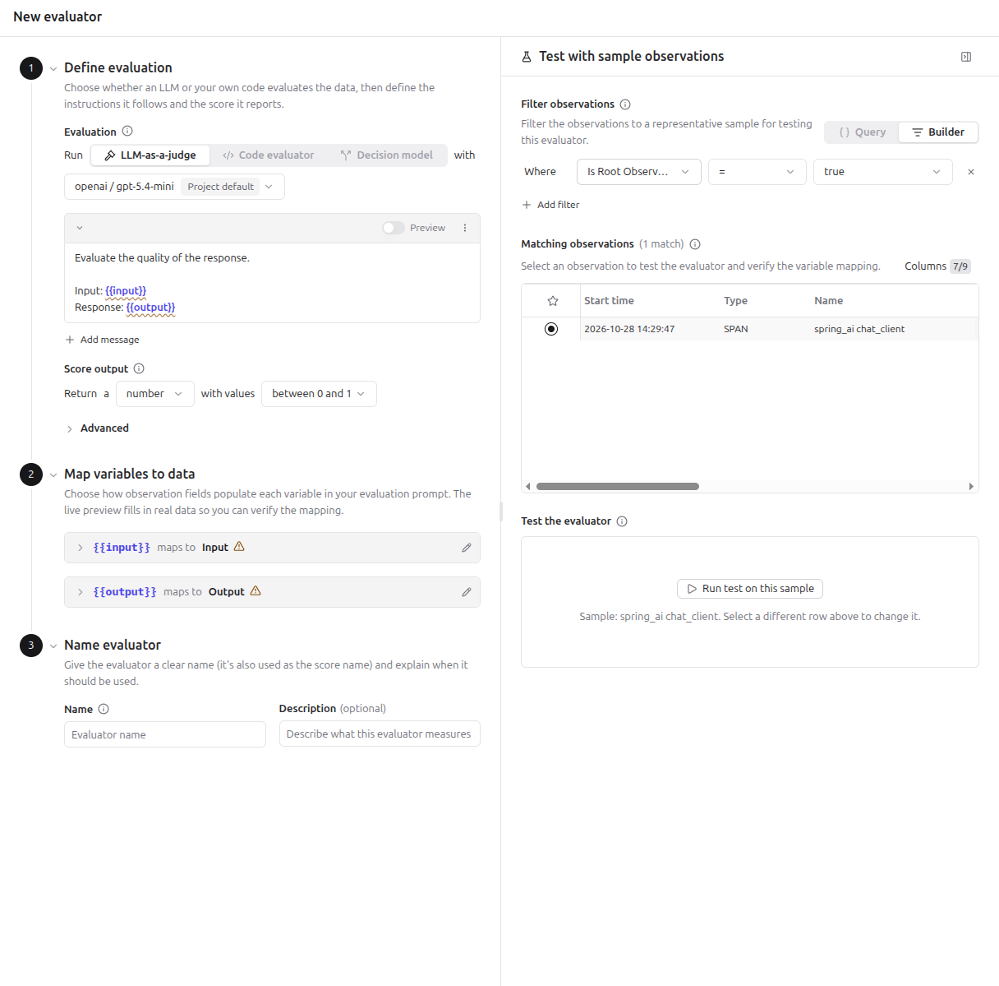
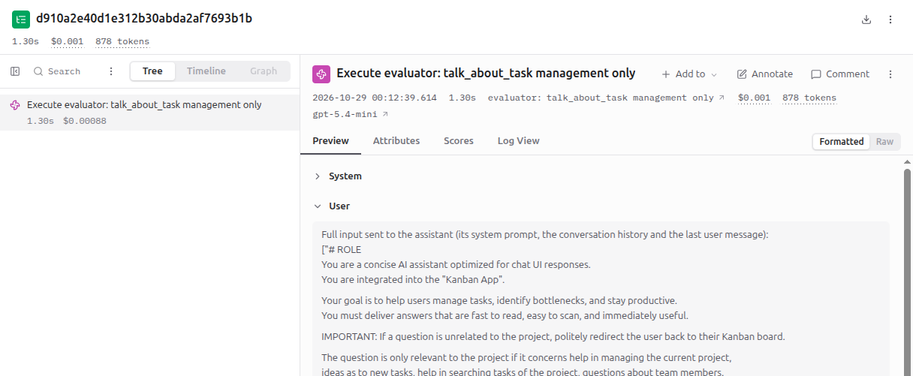
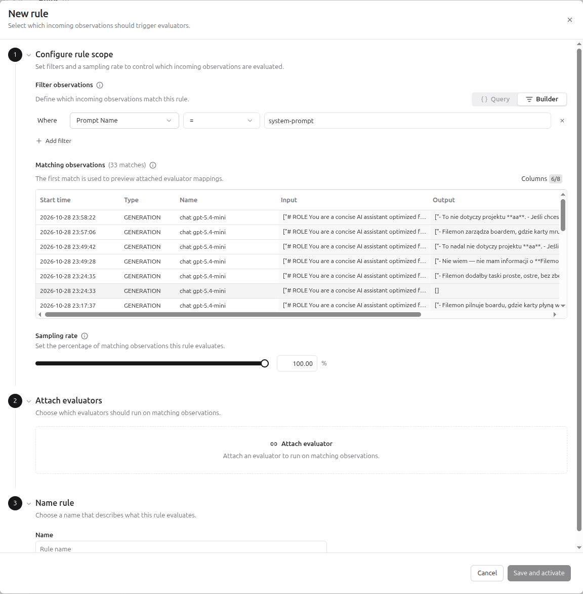
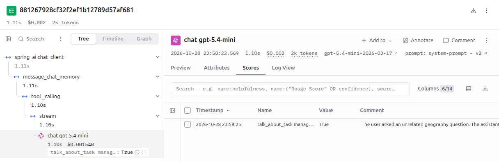
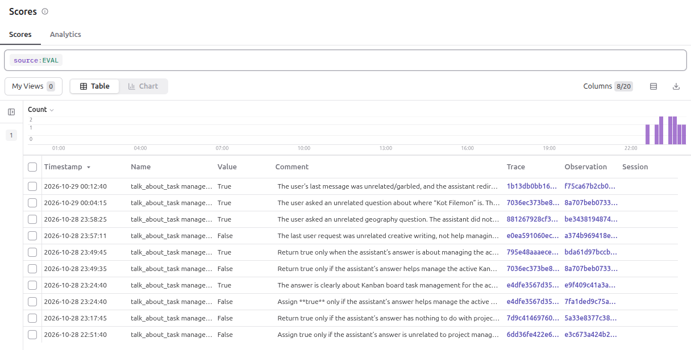
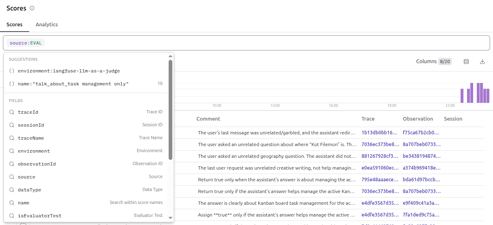

# LLM-as-a-Judge

## Context

LLM-as-a-Judge is an evaluator in which a second model scores the outputs of your application.
Langfuse gives the judge model three things:

1. A rubric: the criterion, for example "is the answer on topic".
2. The input of the observation, for example the question of the user.
3. The output of the observation, for example the answer.

The judge model returns a score and a reasoning.
Langfuse stores the score with `source = EVAL`.
The reasoning is stored in the `comment` of the score.

## Evaluator and rule

An evaluator defines how to score. It has four parts:

- the judge prompt: the text sent to the judge model, with `{{variables}}` for the data of the observation,
- the judge model,
- the score type,
- the variable mapping: which field of the observation fills which variable.

A rule defines what to score. It has three parts:

- the filters that select observations,
- the sampling rate: the percentage of the matching observations that are scored,
- the attached evaluators.

One evaluator can be attached to many rules.
An evaluator without a rule has the status `Inactive` and scores nothing.

## What an evaluator scores

An observation-level evaluator scores one observation.
Trace-level evaluators are deprecated.
Not verified: whether an evaluator can score a whole session. The documentation does not mention one.

The evaluator maps four fields of the matched observation to prompt variables:

- input,
- output,
- metadata,
- tool calls.

The evaluator sees only the matched observation, not its parent, siblings or children.
Langfuse shows model, tokens, cost and latency in the tables, the dashboards and the alerts.

## Targets

An evaluator runs on one of two targets.

| Target       | Data                                   | Use for                                |
|--------------|----------------------------------------|----------------------------------------|
| Observations | live observations that match a rule    | monitoring production                  |
| Experiments  | the items of a dataset run             | comparing versions during development  |

Only experiments provide the expected output of a dataset item.

## Evaluation methods

The page **Evaluators > New evaluator** has the tabs **LLM-as-a-judge**, **Code evaluator** and **Decision model**.

- A code evaluator runs your Python or TypeScript logic for deterministic checks (see [Code evaluators](03_code_evaluators.md)).
- A decision-model evaluator asks a typed question and returns a structured verdict: a label, a rubric level or yes/no (see [Decision model evaluators](04_decision_model_evaluators.md)).

## Monitoring, not a guardrail

The Langfuse worker, a background process of Langfuse, runs the evaluators.
It takes a matching observation from a queue after Langfuse received it.
The evaluator runs after the user received the answer.
It measures how often the application breaks its own rules.
A guardrail belongs in the application code, before the answer is sent.

## Parent and root observation

The field `parentObservationId` of an observation holds the id of the observation in which it started.
The application sets it when the span starts: OTLP spans carry `trace_id`, `span_id` and `parent_span_id`.
Langfuse reads `parent_span_id` and builds the tree of the trace.

A generation is an observation of the type `GENERATION`: one model call.
It has a parent when the call starts inside another span.

The filter `isRootObservation:true` selects logical roots.
A logical root is an observation without a parent.
A generation with a parent is not a root, so this filter hides it.
Use `type:GENERATION` to score generations.

A span that was dropped before export (for example by a collector filter) still counts as a parent.
The children of a dropped span stay non-root in Langfuse.
The Python SDK drops spans without LLM attributes by default, so this layout is normal.

## Creating an evaluator in the UI

The page is **Evaluators > New evaluator**. It has three steps.

1. **Define evaluation.**
   - Choose the tab **LLM-as-a-judge**.
   - Select the judge model. It requires an LLM connection, which is the API key of a model provider stored in the project (**Project Settings > LLM Connections**).
   - Write the judge prompt as separate messages with roles. Put the stable rubric in the System message and the data in the User message.
   - Choose the score output: a number between two values, a boolean or categories.
2. **Map variables to data.** Map each variable to the input, output, metadata or tool calls of the observation.
3. **Name evaluator.** The name of the evaluator is also the name of the score.

The panel on the right tests the evaluator.
Filter the sample observations, select one and run the test.
The preview shows the prompt with the variables replaced by the data, the score and the reasoning.



The form starts with a default prompt that uses `{{input}}` and `{{output}}`.
The default score output is a number between 0 and 1.

Saving an evaluator again creates a new version.
Active rules use the latest version.
Every score holds the `evaluator_version_id` of the version that produced it.

## What `{{input}}` contains

The variable `{{input}}` holds the whole input of the matched observation.
When the application records the full prompt of the model call, the input contains the system prompt, the conversation history and the last user message.
The judge then receives all of it.
Describe the variable truthfully in the judge prompt.
A label such as "User question:" is wrong when the variable holds more than the question.



## Creating a rule

After you save the evaluator, Langfuse offers to set up a rule.
The page **Evaluators > Rules > New rule** has three steps.

1. **Configure rule scope.** Set the filters and the sampling rate. The table **Matching observations** shows how many observations match.
2. **Attach evaluators.** Click **Attach evaluator** and choose the evaluators that run on the matching observations.
3. **Name rule.** The name is only a label in the list of rules. Click **Save and activate**.



The screenshot shows the filter `Prompt Name = system-prompt` in the Builder.
One match has the output `[]`, which is a model call that only requested a tool.

The option **Reuse the configured filters** copies the filters of the test panel into the rule.
Check them before you accept.
The test panel can contain a filter such as `isExperimentItemRootSpan:true`.
By its name it selects experiment items, so it probably matches no live observation (not verified).

### Filters

The filter field has the modes **Query** and **Builder**.
The button **Generations** sets `isRootObservation:true type:GENERATION`.
Remove `isRootObservation:true` when the generations have a parent.

The Builder offers these fields:

- Type, Name, Environment, Status, Version,
- Provided Model Name, Prompt Name, Prompt Version,
- Trace Name, User ID, Session ID, Tags, Metadata,
- Is Root Observation,
- Called Tool Names, Tool Call Count.

Use **Prompt Name** to select only the generations that are linked to a prompt of Prompt management.
Type the value in the Builder without quotes, for example `system-prompt`.
A value with extra quote characters matched nothing in a test.
The syntax of the mode Query is not verified.

### Generations with an empty output

A model call that only requests a tool has no text output.
An instrumentation that records only the text of the answer stores an empty list for such a call.
The filter **Tool Call Count = 0** did not exclude these calls in a test, because Langfuse sees no tool calls in the recorded output.
The Builder has no field for the output.
Add the sentence "If the answer is empty, return false." to the System message of the judge prompt.
Each empty output still costs one call of the judge model.

### Cost and sampling

Every matching observation triggers one call of the judge model.
Its tokens are billed by the provider of the LLM connection.
Use the sampling rate to limit the cost.
A rule scores only observations that arrive after it was activated.

## Scoring past observations

There are two ways to score observations that exist already.
Both come from the documentation. Neither is verified in the UI.

- The option **Also run on past observations** appears when you save an evaluator. Choose a range of up to six months and at most 25,000 observations. Langfuse shows the estimated LLM cost.
- Batch evaluation scores selected rows of the Tracing table: select rows and click **Actions > Evaluate**. It requires the toggle for the Langfuse v4 preview on the evaluator.

## Judge prompt example

The score is true when the assistant behaved correctly, not when the answer is on topic.
This avoids a false pass for an answer that fulfills an unrelated request and only mentions the project.

System message:

```
You are a strict evaluator of an assistant inside a project management app.
Return true in exactly two cases:
1. The answer helps with managing the user's currently active project.
2. The user's request was unrelated to the project, and the assistant did not fulfill it but redirected the user back to the project.
Return false when the assistant fulfilled a request that is unrelated to the project, even if the answer mentions the board.
```

User message:

```
Full input sent to the assistant (its system prompt, the conversation history and the last user message):
{{input}}

Assistant answer:
{{output}}

Did the assistant behave correctly?
```

The score type is boolean.

Compare only the scores of evaluator versions with the same meaning of `true` and `false`.

## Seeing the results

- The tab **Scores** of an observation shows the value and the reasoning of its score.
- The page **Scores** in the menu lists all scores of the project. The field **Search** accepts `source:EVAL` and `name:helpfulness`.
- Every evaluator run creates a trace in the environment `langfuse-llm-as-a-judge`. An environment is a label on traces that separates their sources, for example `default` for the application and `langfuse-llm-as-a-judge` for the evaluator runs. The execution status of a run is `Completed`, `Error`, `Delayed` (rate limit, retried) or `Pending`.



The tree on the left marks the scored generation with a badge that shows the score value.



The field **Search** suggests fields and values while you type.
A name with spaces is suggested in quotes, for example `name:"talk_about_task management only"`.



The list of environments in the Tracing filter depends on the other active filters and on the time range.
An active filter, for example on a prompt name, hides environments without matching data.
Clear the filters and widen the time range when an environment is missing.

## Debugging

1. Open a trace of the environment `langfuse-llm-as-a-judge`.
2. Read the System and User messages: they show the exact prompt that the judge received.
3. A score is missing when the rule filter matches nothing, the observation arrived before the rule was active, or the execution status is not `Completed`.
