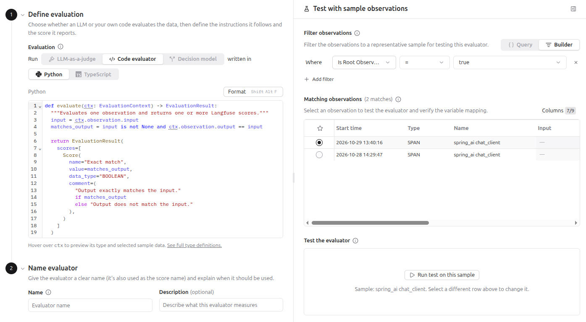

# Code evaluators

## Context

A code evaluator is a function `evaluate`, written in Python or TypeScript, that Langfuse runs on the observations that match a rule.
The function receives the input, the output, the metadata and the tool calls of one observation.
It returns one or more scores.

The same data always gives the same result, so use a code evaluator for checks that need no judgment.
The documentation names these examples:

- regular expression matching,
- JSON validity,
- custom business rules.

## Requirement

The documentation requires that the observations were ingested with an OpenTelemetry-based Langfuse SDK (Python v3+ or JS/TS v4+).
The function `has_answer_text` below ran on spans that a Java application sent over OTLP, so the requirement did not block them.

## Example

The function checks that the output of an observation has text.
A model call that only requested a tool has the output `[]`, so it gets `False`.

```python
def evaluate(ctx: EvaluationContext) -> EvaluationResult:
  """Checks that the observation has answer text in its output."""
  output = ctx.observation.output
  has_text = output is not None and str(output).strip() not in ("", "[]")

  return EvaluationResult(
    scores=[
      Score(
        name="has_answer_text",
        value=has_text,
        data_type="BOOLEAN",
        comment=(
          "The output contains answer text."
          if has_text
          else "The output is empty."
        ),
      )
    ]
  )
```

The function works in three steps:

1. `ctx.observation.output` reads the output of the evaluated observation.
2. `has_text` is `True` when the output exists and is neither empty nor `[]`.
3. `EvaluationResult(...)` returns one score to Langfuse with the name `has_answer_text`, the type boolean, the value `has_text` and a short comment.

## Testing the function

1. Open **Evaluators**, click **New evaluator** and choose the card **Code** in the gallery.
2. Select **Python** and paste the function into the code editor on the left.
3. Use the panel **Test with sample observations** on the right. It has a filter field and the table **Matching observations**.
4. Select one observation in the table.
5. Click **Run test on this sample**. The panel shows the score that your function returned.

The test shows the score only in the panel.



## Runtime limits

Langfuse runs the function in a sandbox.

- Only the standard library of the language is available.
- The function has no network access.
- The function must finish within 2 seconds.

A check that needs a third-party library or an API call runs in your own infrastructure.
Your application then sends the result as a score over the REST API with `POST /api/public/scores`.
