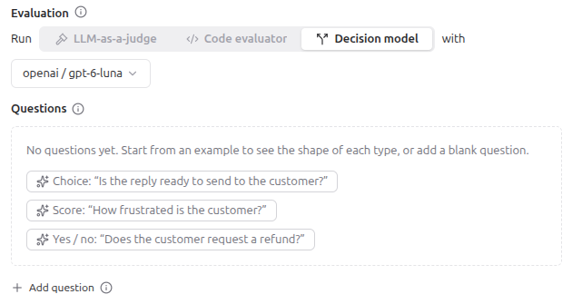

# Decision model evaluators

## Context

A decision model evaluator is the third type of evaluator, next to [LLM-as-a-Judge](02_llm_as_a_judge.md) and [code evaluators](03_code_evaluators.md).
It answers questions of a fixed type instead of generating text with reasoning.
Each question writes one score.

It is usually cheaper than an LLM judge.
Use an LLM judge when you need the reasoning in the `comment` of the score.

## Question types

| Type         | Langfuse score                                                | Example                                                              |
|--------------|---------------------------------------------------------------|----------------------------------------------------------------------|
| **Choice**   | categorical score with the selected option                    | "Which team should handle this ticket?" gives `billing`, `technical` or `sales` |
| **Score**    | numeric score with a level from `0` to `levels - 1`           | "How frustrated is the customer?" gives `0` (calm) to `3` (angry)    |
| **Yes / no** | numeric score with the probability `P(true)` from `0` to `1`  | "Does the message request a refund?" gives `0.93`                    |

The form **New evaluator** offers one example question for each type after you choose the tab **Decision model**.

