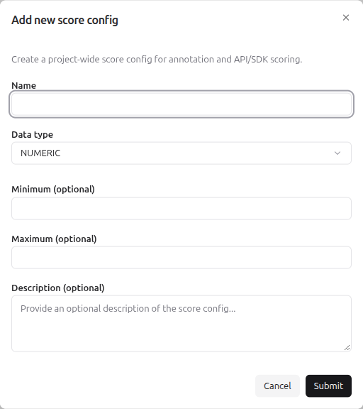
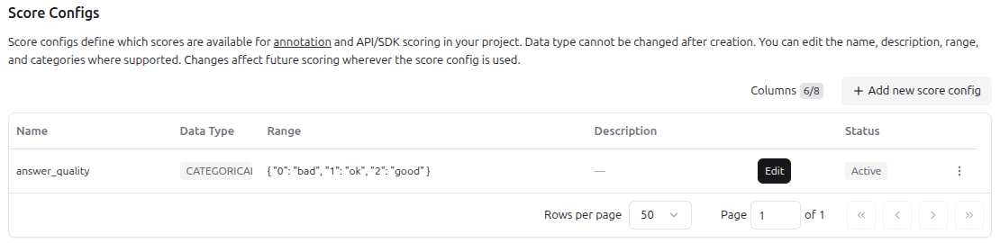
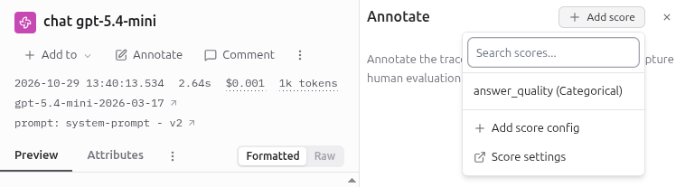

# Manual scores in the UI

## Context

Manual scoring means that you rate a trace, a session or an observation yourself in the Langfuse UI.
Langfuse saves the rating as a score with `source = ANNOTATION`.
The scores of evaluators have `source = EVAL`.

## Score config

A score config is the schema of a score: its name, data type and allowed values (see [Scores](01_scores.md)).
The annotation form in the UI offers only existing score configs, so create at least one first.

Create a config in **Project Settings > Scores Configs** with the button **Add new score config**.
Fill in:

- the score name,
- the data type: `NUMERIC`, `CATEGORICAL`, `BOOLEAN` or `TEXT`,
- the constraints: minimum and maximum for numeric, the categories for categorical.

After you click **Submit**, the config appears in the list **Scores Configs** and in the dropdown of the panel **Annotate**.
Archive a config to remove it from that dropdown.

Example: the config `answer_quality` with the type `CATEGORICAL` and the categories `good`, `ok` and `bad`.

## Scoring by hand

1. Open a trace, a session or an observation in **Tracing**.
2. Click **Annotate** in the toolbar below the name of the observation. The panel **Annotate** opens on the right.
3. Click **Add score** and select a score config from the list.
4. Set the value.
5. Add a comment (optional).

The score appears on the tab **Scores** of the same observation.

## Comparing with an evaluator

To check a boolean LLM judge, create a score config of the type `BOOLEAN`.
The comparison is described in [Score analytics](06_score_analytics.md).
