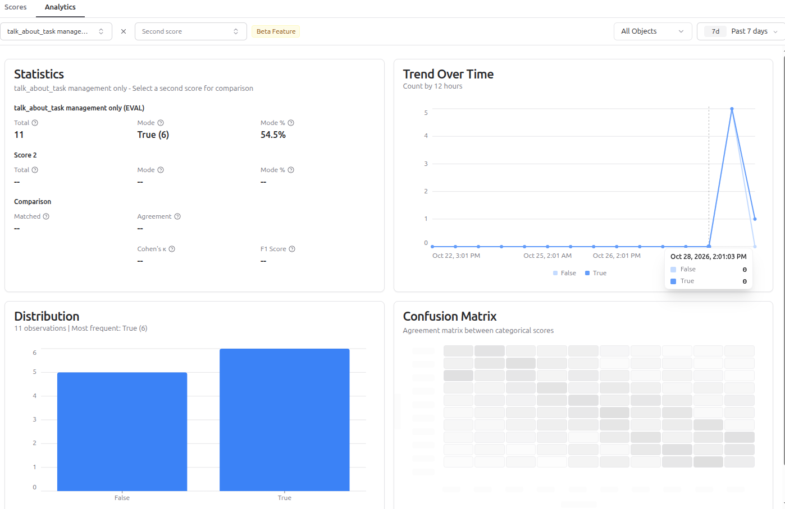

# Score analytics

## Context

Score analytics is the tab **Analytics** on the page **Scores**.
It analyzes scores without any configuration.
The documentation describes it as a beta feature.

## Analyzing one score

1. Open **Scores > Analytics**.
2. Select a score from the list.
3. Select the object type: Traces, Observations, Sessions or Dataset Run Items (the items of a dataset run, a later lesson).
4. Set the time range.

The page shows three things:

- statistics: the number of scores and, for boolean scores, the most frequent value,
- the distribution of the values,
- the trend over time.

## Comparing two scores

The tab compares two scores attached to the same observation.
For boolean scores it shows Cohen's Kappa and Overall Agreement.
Cohen's Kappa measures the agreement of two raters and corrects for agreement by chance.
Overall Agreement is the share of objects on which both scores have the same value.

## Human and judge agreement

The documentation calls this use "Human vs AI Annotation Agreement".
Compare an evaluator score (`EVAL`) with a manual score (`ANNOTATION`).
A boolean judge needs a manual score config of the type `BOOLEAN` (see [Manual scores](05_manual_scores.md)).
When the agreement is low, change the judge prompt and compare again.

## Scores with different meanings

Scores of one name from evaluator versions with opposite meanings of `true` and `false` distort the distribution.
Separate the versions in one of two ways:

- Restrict the time range to the period after the last change of the judge prompt.
- Rename the evaluator, because its name is the name of the score.
