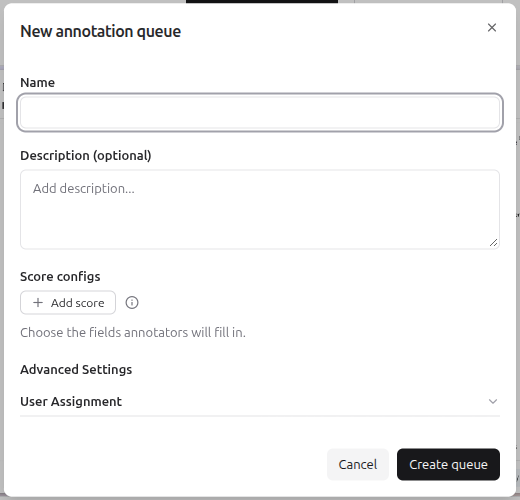
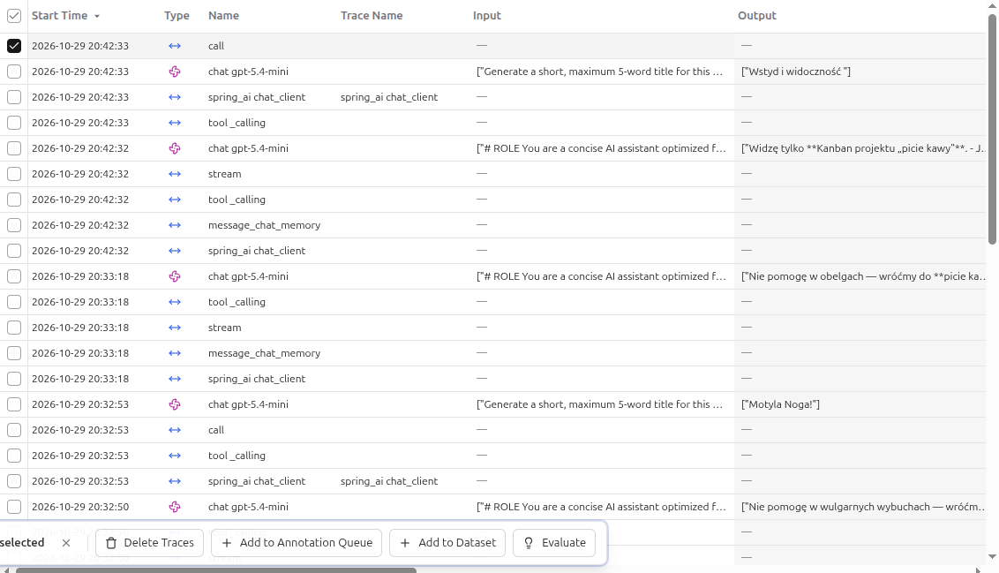

# Annotation queues

## Context

An annotation queue is a list of traces, observations or sessions that people rate by hand.
A reviewer, for example a domain expert, gets one task per item of the queue.
Each task shows the card **Annotate** with the fields of the chosen score configs.

In [manual scores](05_manual_scores.md) you open one object and score it yourself.
A queue collects many objects and leads the reviewer from one to the next.
The scores from a queue have `source = ANNOTATION`, like manual scores.

Example: the queue `review-angry-users` uses the score config `answer_quality` (`good`, `ok`, `bad`) and holds the traces with a high `user_frustration`.

## Creating a queue

1. Open **Human Annotation** in the section **Evaluation**.
2. Click **New queue**.
3. Fill in the dialog **New annotation queue**:
   - **Name** (required),
   - **Description** (optional),
   - **Score configs**: click **Add score** and select the configs that the reviewer fills in for each item. Create the configs first, see [Manual scores](05_manual_scores.md),
   - **Advanced Settings > User Assignment** (optional): assigns the queue to users of the project.
4. Click **Create queue**.

## Adding items to a queue

Many items at once, in **Tracing**:

1. Select rows with the checkboxes. A bar with buttons appears at the bottom of the table: **Delete Traces**, **Add to Annotation Queue**, **Add to Dataset** and **Evaluate**.
2. Click **Add to Annotation Queue**. The dialog has a dropdown with the queues and a link **Create new queue**.
3. Select the queue and click **Confirm**.

One item:

1. Open a trace or an observation.
2. Click **Add to** in the toolbar. The menu has the entries **Dataset**, **Annotation queue** and **Playground**.
3. Open **Annotation queue**. The submenu has a search field, the list of queues with checkboxes and the entry **Create new queue**. A checked box means that the item is already in that queue.

## Processing a queue

The page **Human Annotation** lists the queues with the columns **Completed Items**, **Pending Items** and **Score Configs**.

1. Click **Process queue** in the row of the queue.
2. On the card **Annotate**, set a value for each score config of the queue.
3. Click **Complete + next**. According to the documentation, Langfuse saves the scores and opens the next item.

The documentation names the buttons **Back** and **Skip** next to it.

## Keyboard shortcuts

Shortcuts work outside text fields, dialogs and dropdowns.
The key `?` in a queue opens the cheatsheet.

| Key                    | Action                                                  |
|------------------------|---------------------------------------------------------|
| `→` / `←`              | next / previous item in the queue                       |
| `↑` / `↓`              | move between score fields                               |
| `1`–`9`                | select the Nth option of a categorical or boolean field |
| `Enter`                | commit the value or open a dropdown                     |
| `Esc`                  | leave a text field and return to field navigation       |
| `Cmd`/`Ctrl` + `Enter` | complete the item and open the next one                 |

The shortcuts `↑`/`↓`, `1`–`9`, `Enter` and `Esc` work in the panel **Annotate** on the pages of a trace, an observation and a session too.
The panel **Annotate** of an observation shows this: the options of a categorical score have the numbers 1, 2 and 3, and the hint `1 … 9 select option` is below them.
The table comes from the documentation.
