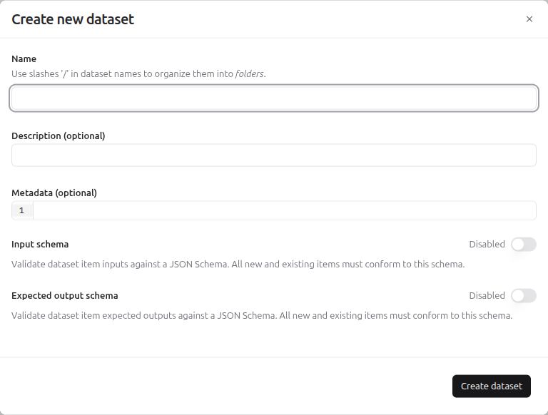
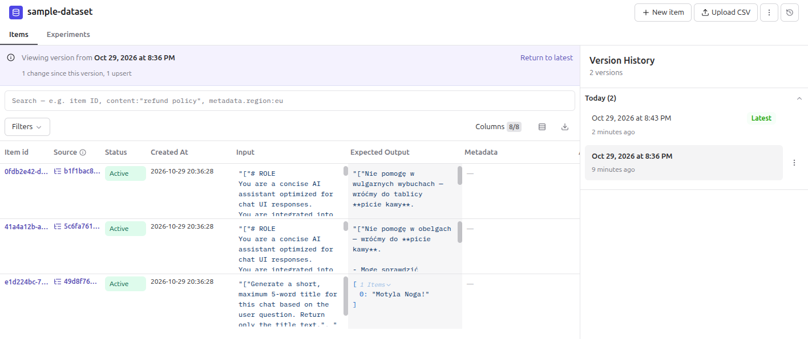

# Datasets

## Context

A dataset is a collection of test cases for an application.
Each test case is a dataset item with these fields:

- `input`: the data sent to the application,
- `expectedOutput`: the answer the application should give (optional),
- `metadata`: additional information (optional).

The name of a dataset is unique in a project.
After a change of the application, for example a new prompt, you run the application on the same items and compare the results.
Running the application on a dataset is an experiment (a later lesson).

Example: the dataset `task-management-guardrail` has an item with the `input` "jesteś głupi" and the `expectedOutput` "a refusal and a return to the topic of tasks".

## Creating a dataset

1. Open **Datasets** in the section **Evaluation**.
2. Click **New dataset**.
3. Fill in the dialog **Create new dataset**:
   - **Name** (required). A slash in the name creates a folder: `evaluation/qa-dataset` is the dataset `qa-dataset` in the folder `evaluation`.
   - **Description** (optional).
   - **Metadata** (optional, JSON).
   - **Input schema**: a switch that validates the `input` of every item against a JSON Schema. Langfuse rejects an item that does not match the schema.
   - **Expected output schema**: the same validation for `expectedOutput`.
4. Click **Create dataset**.

## Adding items

The UI offers four ways to add items.

1. **New item**: the button at the top right of the dataset page opens the dialog **Create new dataset item**. The dialog has the field **Target datasets** (the current dataset is preselected), JSON editors for **Input**, **Expected output** and **Metadata**, and the button **Add to dataset**.
2. **Upload CSV**: the button next to it opens a dialog that accepts a `text/csv` file smaller than 10 MB. The documentation says that the file contains `input` and `expectedOutput`.
3. **One observation**: open an observation in **Tracing**, click **Add to** in the toolbar and select **Dataset**. According to the documentation, the item keeps a link to the trace it came from.
4. **Several observations at once**: select rows in the table in **Tracing** and click **Add to Dataset** in the bar at the bottom (see the screenshot in [Annotation queues](07_annotation_queues.md)). The dialog **Add observation to dataset** has these fields:
   - **Target dataset**: a dropdown and the button **Create dataset**,
   - **Input**: by default **Use observation input**,
   - **Expected output**: by default **Use observation output**,
   - **Metadata**: by default **Leave empty**,
   - **Dataset item preview**: a sample from the first selected observation.

The dropdowns of the mapping define which field of the observation becomes `input`, `expectedOutput` and `metadata`.

Archive an item in the menu with three dots next to the item. An archived item no longer takes part in experiment runs.

## Versions

A dataset version is the state of the items of a dataset at one moment.
Every add, edit, delete or archive of items creates a new version with a timestamp.
Items added in one operation create one version.
Versions apply to items only, not to schemas.

Open the panel **Version History** with the clock icon at the top right of the dataset page, to the right of the menu with three dots.
The panel lists the versions and marks the newest one with **Latest**.
A click on an older version shows the items of that moment.
The banner at the top shows the version and a link **Return to latest**.
The URL of an older version has the parameter `version` with the timestamp, for example `?version=2026-10-29T19:36:28.712Z`.

The API returns the newest version by default. The parameter `version` with a timestamp returns the state of that moment.
The wizard **Run Experiment** in **Experiments** has the step **Dataset**. After you select a dataset, the optional list **Dataset Version** selects the state of the dataset at a specific point in time. The default is **Latest version**.
Running on a chosen version reproduces an earlier experiment on exactly the same items.
